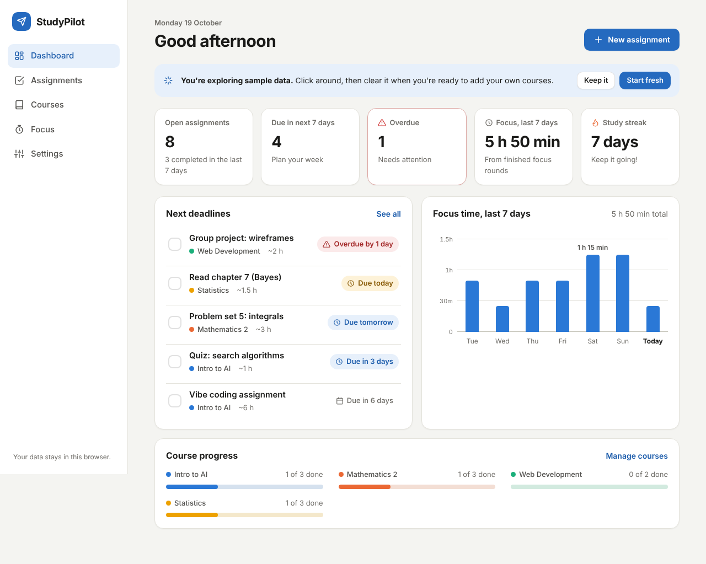
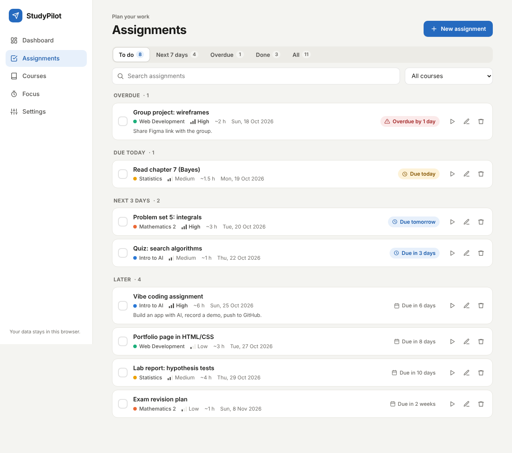
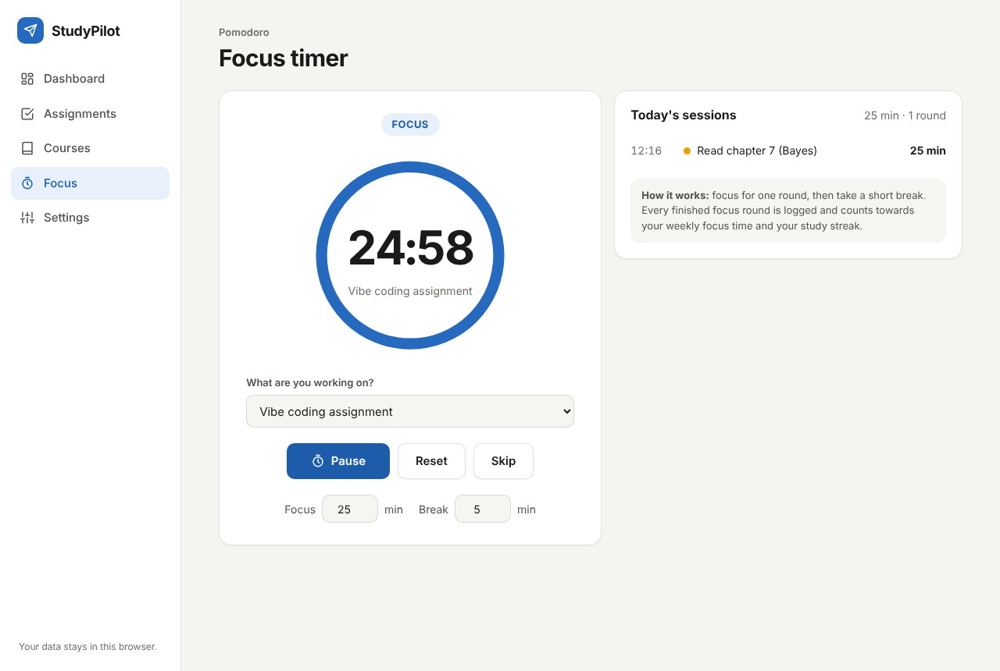

# StudyPilot – a study planner built with AI

**StudyPilot** helps students keep track of assignments across courses and actually sit down and work on them.
It combines a deadline planner, per-course progress tracking and a Pomodoro focus timer in one simple web app.

> Built for the *Intro to AI* "Vibe Coding" assignment – the app was planned, written, tested and improved with generative AI.

**Live demo:** https://telily.github.io/Intro-ki-3/  
**Source code:** https://github.com/Telily/Intro-ki-3



## The problem

As a student you juggle several courses, each with its own deadlines spread across Canvas, emails and notes.
It is easy to lose track of what is due next – and even when you know, it is hard to get started.
StudyPilot puts every deadline in one list, shows what is urgent, and gives you a timer to start working right away.

## Features

| Feature | What it does |
|---|---|
| **Dashboard** | Overview of open, upcoming and overdue assignments, focus time for the last 7 days (bar chart with tooltips), a study streak and progress per course. |
| **Assignments** | Add / edit / delete assignments with course, due date, priority, time estimate and notes. Grouped into *Overdue, Due today, Next 3 days, Later, Completed*. Filter by status or course and search by text. Mark as done with one click (with **Undo**). |
| **Courses** | Each course gets its own colour, a progress bar, number of open assignments, next deadline and total focus time. |
| **Focus timer** | Pomodoro timer (default 25 min focus / 5 min break, adjustable). Pick the assignment you are working on – finished rounds are logged and count towards your stats. Plays a short sound when a round ends and shows the countdown in the browser tab. |
| **Settings** | Light / dark / system theme, export & import a JSON backup, load sample data, delete all data. |

Extra details: works on phones (bottom tab bar), keyboard shortcut **N** for a new assignment, sample data on first visit so the app is easy to explore.

<p>
  
  
</p>

## Privacy

There is no server, no login and no API keys. All data is stored only in your own browser (`localStorage`).
The sample data is made up.

## How to run it

It is a static website – plain HTML, CSS and JavaScript, no build step and no frameworks.

- **Easiest:** double-click `index.html` to open it in your browser.
- **Or** serve the folder, e.g. `python3 -m http.server` and open <http://localhost:8000>.

## Project structure

```
index.html          page layout, the five views and the dialogs
css/style.css       all styling, light + dark theme, mobile layout
js/logic.js         pure logic: dates, sorting, filtering, statistics, validation (unit tested)
js/app.js           user interface: rendering, events, timer, saving to localStorage
tests/logic.test.js 18 unit tests for js/logic.js
tests/e2e/          end-to-end browser test that clicks through the whole app
docs/               screenshots
```

## Testing

**Unit tests** (needs Node.js 18+, no install needed):

```bash
npm test
```

18 tests cover date maths (including the daylight-saving change and invalid dates like 31 February),
deadline labels, sorting and filtering, statistics, the study streak, input validation, and repairing corrupted saved data.

**End-to-end tests** (opens the real app in a headless Chromium browser):

```bash
npm install
npx playwright install chromium
npm run test:e2e
```

14 steps: adding an assignment (incl. validation errors), filters and search, check-off and undo, edit and delete,
adding/deleting courses (duplicate names rejected), running a full focus round, data surviving a reload,
dark mode, clearing the sample data, recovering from corrupted storage, no horizontal scrolling on a 375 px phone screen,
and no JavaScript errors in the console.

I also checked every screen visually with screenshots in light mode, dark mode and on a phone-sized screen.

## How I used AI

The app was built with **Claude** (Anthropic) in the Claude desktop app (Cowork mode), which can write files directly
into my project folder and run code and tests.

1. **Idea & planning** – I gave Claude the assignment text. It asked me to choose between a few app ideas (study planner,
   budget tracker, café ordering system, Finn-style marketplace), where to save the code and which language to use.
   I chose a study planner in English.
2. **Design** – Claude proposed the feature set (deadlines, courses, Pomodoro timer, dashboard) and a structure that keeps
   the logic (`logic.js`) separate from the user interface (`app.js`) so the logic can be tested on its own.
   It chose a plain HTML/CSS/JS static site so it can be opened by double-clicking and hosted for free on GitHub Pages.
3. **Code generation** – Claude wrote the HTML, CSS and JavaScript, including dark mode, mobile layout and accessibility
   details (keyboard focus, screen-reader labels, a hidden data table behind the chart).
4. **Testing** – Claude wrote unit tests and an automated browser test, ran them, and took screenshots to review the design.
5. **Improving** – see below.

### Bugs found and fixed during testing

| What testing showed | Fix |
|---|---|
| Screenshot review: on a **Monday** the "Focus this week" chart and "completed this week" were empty, even with lots of recent study time, because the week had just restarted. | Changed to a rolling **last 7 days** window and added a regression test for Mondays. |
| The sample "today" focus session was shown at 00:00, which looked odd. | Sample session now ends an hour before the current time. |
| On phones the checkbox floated in the middle of tall assignment cards. | Aligned it to the top of the card on small screens. |
| Two end-to-end test steps failed because the test checked the page before it had finished re-rendering (the app itself was fine). | Made the test wait for the page to update. |
| One unit test failed – the expected number in the test was miscalculated, the code was right. | Corrected the test. |

### Reflection

I picked a study planner because keeping track of deadlines across different courses is something I actually struggle with. Usually they're spread out over Canvas, emails and my own notes.

What surprised me most was how fast it went from an idea to something that actually works. I described what I wanted in normal language, and instead of just spitting out code, the AI first asked me a few questions (what kind of app, where to save it, which language). That made the result feel more like *my* app and less like a random template.

The part I learned the most from was testing. I didn't expect that, since I didn't write the tests myself. The AI wrote automated tests and took screenshots of every page, and that's how we found a bug I would never have noticed: because I built the app on a Monday, the "this week" chart was completely empty even though there was lots of study time from the days before. We changed it to show the last 7 days instead. Some of the tests also failed because the *test* was wrong, not the app, which showed me you can't blindly trust either the code or the tests.

Not everything was automatic. I had to make my own decisions, and I had to figure out GitHub Pages myself. My repository was private, so Pages didn't work until I made it public. At first I also mixed up the link to the code (github.com) with the link to the live website (github.io).

My takeaway is that AI is really good at turning an idea into working code quickly. You still need to understand what you want, check that it actually works, and make the decisions along the way. If I continued, I would add reminders before deadlines, a calendar view and maybe a way to import deadlines straight from Canvas.

## Publishing on GitHub Pages

1. Open the repository in **GitHub Desktop** and click **Publish repository** (untick *Keep this code private*).
2. On github.com open the repo → **Settings → Pages** → *Source: Deploy from a branch* → branch **main**, folder **/ (root)** → **Save**.
3. After a minute the app is live at https://telily.github.io/Intro-ki-3/.
